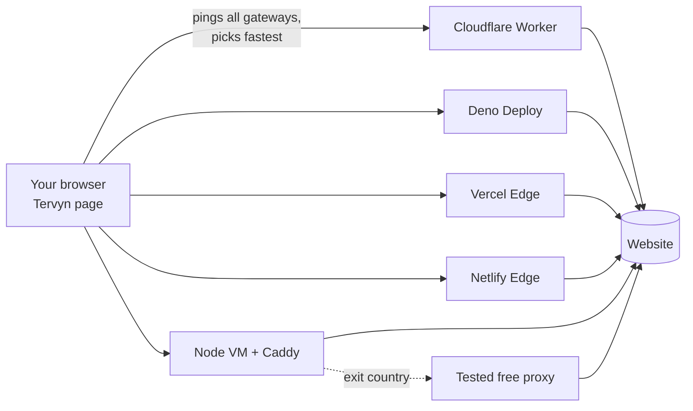

# Tervyn Web Proxy: free, no install

The no-install side of [Tervyn VPN](https://github.com/Fadi-yt1/vpn). Open the Tervyn page, type a site, and it loads through the fastest free gateway. Nothing to install, no account.

One gateway codebase runs on **every free hosting tier**:

| Where | Free plan | Why it's useful |
|---|---|---|
| **Cloudflare Workers** | yes | 300+ cities, anycast, HTTP/3 on by default |
| **Deno Deploy** | yes | global edge, Web standard runtime |
| **Vercel Edge Functions** | Hobby (non-commercial) | global edge network |
| **Netlify Edge Functions** | Starter | Deno-based edge |
| **Your own free VM** (Oracle Cloud Always Free, Google Cloud e2-micro, AWS free tier…) | yes | fixed region, **free exit countries** |

The home page tests **all** gateways from your browser and uses the fastest one. You can pick another one, and the list re-tests on demand.

On Node gateways you can also choose an **exit country**. Traffic then leaves through free public proxies from the same 18 lists the extension uses. Each one is tested first: it must load a Cloudflare page over HTTPS with a valid certificate.



## Try it locally (30 seconds)

```bash
npm start
```

Open http://localhost:8080 and type a site. Needs Node 20+ and no `npm install`, because there are no dependencies.

## Deploy to all the free platforms

Do the platforms you want; each one is independent. After each deploy, add its URL to `gateways.json`, then run `npm run build` and redeploy, so every gateway lists every other one:

```json
{ "gateways": ["https://tervyn-gateway.you.workers.dev", "https://tervyn.deno.dev", "https://tervyn.vercel.app", "https://tervyn.netlify.app", "https://gw1.example.com"] }
```

(Or set the `GATEWAYS` environment variable, comma separated, on any platform.)

**Cloudflare Workers**

```bash
npx wrangler login
```

```bash
npx wrangler deploy
```

**Deno Deploy**: create a project at https://deno.com/deploy, link this repository, and set the entrypoint to `platforms/deno/main.js`. Or deploy from the command line with `deno deploy` (see Deno's docs for the current command). To run it on any machine with Deno:

```bash
deno run --allow-net --allow-env platforms/deno/main.js
```

**Vercel** (`vercel.json` routes every path to `api/gateway.js`):

```bash
npx vercel deploy --prod
```

**Netlify** (`netlify.toml` + `netlify/edge-functions/gateway.js`):

```bash
npx netlify-cli deploy --prod
```

**Free VM** (HTTPS, HTTP/2 and HTTP/3 through Caddy, plus exit countries). Point a DNS name at the VM, open ports 80, 443 and 443/udp, then:

```bash
DOMAIN=gw1.example.com REGION=Frankfurt docker compose up -d
```

```bash
sudo bash platforms/node/tune-linux.sh
```

The second command is optional: it turns on BBR and larger TCP buffers.

**Deploy everything from GitHub**: `.github/workflows/deploy.yml` deploys to Cloudflare, Vercel and Netlify on every push to `main`, for each platform whose token you add as a repository secret. The workflow file lists the secret names.

> **Check each provider's rules first.** Some free plans restrict proxies or the kind of traffic you may serve. Vercel Hobby is for non-commercial use only. Read the terms of service and acceptable-use policy of every platform before you deploy, and keep the gateway for light browsing.

## Node gateway settings

| Variable | Default | |
|---|---|---|
| `PORT` | 8080 | listen port |
| `EXITS` | off | `1` = offer free exit countries |
| `REGION` | | label in the gateway list, e.g. `Frankfurt` |
| `GATEWAYS` | | more gateway URLs, comma separated |
| `TRUST_PROXY` | off | `1` behind Caddy/another proxy (reads `X-Forwarded-*`) |
| `RATE_LIMIT` | 900 | requests per minute per IP |
| `CACHE_MB` | 128 | memory for the shared static-asset cache, `0` = off |

## What makes it fast

These are the speed measures from the plan. All are in the code today:

- **Edge first.** Four of the five platforms run in many cities. The browser connects to a nearby node over a short round trip, and Cloudflare also uses anycast.
- **Fastest gateway wins.** The home page pings every gateway twice. The second ping reuses the connection, which matches real browsing. It then picks the lowest-latency one.
- **Modern protocols.** Cloudflare, Deno, Vercel and Netlify serve HTTP/2 and HTTP/3 with TLS 1.3 automatically. On VMs, Caddy adds HTTP/3 (QUIC), TLS 1.3 and session resumption.
- **Connection reuse to sites.** The Node gateway keeps pools of keep-alive connections per site with TLS session caching. Repeat requests skip the TCP and TLS handshakes. Edge platforms pool connections themselves.
- **Shared cache.** Public static files (CSS, JS, images, fonts) are cached and served to every user of that gateway: the Cloudflare/Deno Cache API on the edge, an LRU memory cache on Node. HTML is never cached.
- **Brotli.** The Node gateway compresses text with Brotli level 4, close to gzip's speed and smaller. Edge platforms compress automatically.
- **Streaming.** Images, video and downloads stream straight through. Range requests pass through, so video seeking works.
- **No redirect hops.** The `/p/https/site.com/path` URL keeps relative links working without rewriting. Redirects are rewritten so they stay on the gateway.

## How pages keep working

1. **The gateway rewrites pages.** Links, images, scripts, forms, `srcset`, CSS `url()` and redirects all point back to `/p/…`. Headers that would block the page (CSP, X-Frame-Options, HSTS) are removed. Cookies are scoped to `/p/https/site.com/`, so sites can't read each other's cookies.
2. **A small script runs in each page.** It patches `fetch`, XHR, `history.pushState`, `window.open` and link clicks. It also installs the service worker and shows the Tervyn toolbar (bottom left: change site, Home, open directly, hide).
3. **A service worker catches the rest.** Requests a page script builds at runtime, such as cross-origin `import()`, go through the gateway too. Sites can't install their own service worker, which would take over the gateway.
4. **There is a server-side safety net.** A root-relative request that still escapes (`/api/x`) is recovered from its Referer and redirected to the right site.

## Limits and safety

- **This is a web proxy, not a VPN.** Very script-heavy apps (some Google and Microsoft logins, sites that check `location.hostname`), WebSockets and WebRTC may not work. For those, use the [extension](https://github.com/Fadi-yt1/vpn).
- **The gateway sees what you browse.** It sees the sites you open and their content, because it must rewrite pages. The gateway code doesn't log requests. The hosting platforms may keep their own request logs, though. So avoid banking and other sensitive logins.
- **Free exit countries are run by unknown people.** HTTPS sites stay encrypted between the gateway and the site, and every exit must pass a certificate check, but they are slower and come and go.
- **Abuse protection:** per-IP rate limits, a 10 MB upload cap, private networks blocked (localhost, 10/8, 192.168/16, 169.254.169.254 cloud metadata, IPv6 local and more, checked again after DNS on Node), dangerous ports blocked, and `robots.txt` that disallows crawling.
- **Cloudflare's free plan has a 10 ms CPU limit per request.** Very large HTML pages may hit it. Other files stream through with almost no CPU. See the roadmap in `docs/ARCHITECTURE.md`.

## Testing and benchmarks

```bash
npm test
```

Runs the unit tests and the gateway end-to-end test: local site, redirects, cookies, gzip, POST, cache, SSRF, and exit countries through fake HTTP CONNECT and SOCKS5 proxies.

```bash
npm run e2e
```

Runs a real-browser test (Playwright): service worker, toolbar, pushState, and checks that no request reaches the site directly.

```bash
DENO_BIN=$(which deno) WRANGLER_BIN=node_modules/.bin/wrangler node tests/platforms.mjs
```

Runs the same checks on Deno and Cloudflare's real Workers runtime.

Benchmarks, to measure against direct browsing and other web proxies:

```bash
bash bench/compare.sh
```

Median TTFB and total time per site: direct, each gateway, and `OTHER=…` for another proxy.

```bash
node bench/pageload.mjs
```

Full page loads in Chromium (first byte, first paint, load).

```bash
bash bench/load.sh https://gw.example.com
```

Throughput under load (oha / wrk / autocannon).

## Files

```
gateway/core.js          the gateway: routing, headers, cookies, cache, rate limit (all platforms)
gateway/rewrite.js       HTML / CSS / header rewriting
gateway/url.js           /p/ URL scheme and private-network guard
gateway/static/          home page, in-page script + toolbar, service worker (bundled by npm run build)
platforms/cloudflare/    Workers adapter        (wrangler.toml)
platforms/deno/          Deno Deploy adapter
api/gateway.js           Vercel Edge adapter    (vercel.json)
netlify/edge-functions/  Netlify Edge adapter   (netlify.toml)
platforms/node/          Node server, keep-alive upstream, cache, free exit pool, Caddyfile, Linux tuning
bench/                   benchmark scripts
docs/ARCHITECTURE.md     design, trade-offs, roadmap
```

After editing anything in `gateway/static/` or `gateways.json`, run `npm run build`. It regenerates `gateway/assets.js`, and `npm test` checks that it's up to date.
