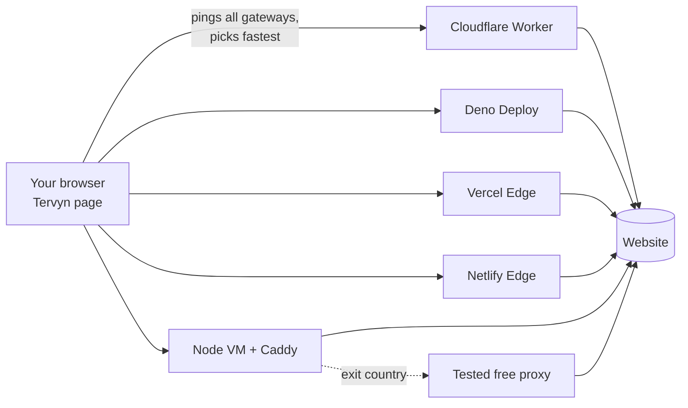

# Tervyn Web Proxy: free, no install

The no-install side of [Tervyn VPN](https://github.com/Fadi-yt1/vpn). Open the Tervyn page, type a site, and it loads through the fastest free gateway. Nothing to install, no account.

One gateway codebase runs on **every free hosting tier**:

| Where | Free plan | Why it's useful |
|---|---|---|
| **Cloudflare Workers** | yes | 300+ cities, anycast, HTTP/3 on by default |
| **Deno Deploy** | yes | global edge, Web standard runtime |
| **Vercel Edge Functions** | Hobby (non-commercial) | global edge network |
| **Netlify Edge Functions** | Starter | Deno-based edge |
| **Your own free VM** (Oracle Cloud Always Free, Google Cloud e2-micro, AWS free tier…) | yes | fixed region, **free exit countries** |

The home page tests **all** gateways from your browser and uses the fastest one. You can pick another one, and the list re-tests on demand.

On Node gateways you can also choose an **exit country**. Traffic then leaves through free public proxies from the same 18 lists the extension uses. Each one is tested first: it must load a Cloudflare page over HTTPS with a valid certificate.



## Countries (USA, Canada and more) through real free proxies

Pick a **Location** on the home page, or in the toolbar on any page, and every site you open goes out through a real free proxy in that country.

- **Where the servers come from:** every 30 minutes, `.github/workflows/proxies.yml` (free on GitHub Actions) downloads about 30 public free-proxy lists. These include ProxyScrape, Geonode, Proxifly, monosans, TheSpeedX and the 18 lists the extension uses. It tests every server.
- **How a server qualifies:** it must open `https://www.cloudflare.com` with a **valid certificate** twice. That proves it works for secure sites and doesn't tamper with them, and the page reveals its **real country**. Up to 40 of the fastest per country are published as `proxies.json` on the `proxies` branch.
- **How a request goes through:** with a country picked, requests go to the Vercel gateway's **Node function** (`api/exit.js`; `vercel.json` routes there when the country cookie is set). It opens a raw TCP connection to a proxy in that country (HTTP CONNECT or SOCKS5), then speaks TLS **directly with the site** through it. The free proxy only relays encrypted bytes it can't read. If a proxy fails, the next one is tried, and dead ones are skipped for 10 minutes.
- **Which gateways support it:** Vercel (Node function) and self-hosted Node or Deno gateways. When you pick a country, the home page automatically uses a gateway that supports it. Cloudflare Workers can only tunnel plain HTTP: upgrading the tunnel to TLS fails there, so countries are turned off on Cloudflare (`EXITS=1` turns them on for testing). `/__tervyn/exits/check?cc=US` on the Cloudflare gateway shows where each proxy stops.
- **Why not VPN Gate?** vpngate.net and similar sites hand out OpenVPN, L2TP and SSTP VPN servers. Websites, browsers and edge servers can't speak those protocols, so they can't be used here (or in a browser extension). Their desktop VPN client works for that.

**Using your own proxies instead (e.g. Webshare):** add a repository secret named `PRIVATE_PROXIES` with your proxy list, one per line, in any layout (`ip:port:user:pass`, `user:pass@ip:port`, `socks5://user:pass@ip:port`). Then run the deploy workflow. The country menu then offers **only** your proxies, grouped by their real country, rotating across them. The logins stay in the secret and Vercel's private settings: they're never in the repo or shown on any page.

Free proxies are slower than the gateways and are run by unknown people. HTTPS keeps the page content private, but don't log in to anything important through them.

## Try it locally (30 seconds)

```bash
npm start
```

Open http://localhost:8080 and type a site. Needs Node 20+ and no `npm install`, because there are no dependencies.

## Deploy (all free)

**The portal** (`index.html` + `gateways.json` at the repo root) is what users open. GitHub Pages serves it free at `https://<owner>.github.io/tervyn/`. It tests every live gateway from the visitor's browser and sends them through the fastest. `npm run build` regenerates it.

**The gateways deploy automatically from GitHub.** Create free accounts, add one token per platform as a repository secret (Settings → Secrets and variables → Actions), then run the **deploy** workflow (Actions → deploy → Run workflow) or push. The workflow:

1. deploys to every platform that has a token;
2. finds each live URL and adds it to `gateways.json`;
3. redeploys, so every gateway lists every other one;
4. smoke-tests each gateway through `https://example.com`;
5. commits the live list, so the portal picks it up.

| Platform | Secret(s) | Where to get it |
|---|---|---|
| Cloudflare Workers | `CLOUDFLARE_API_TOKEN` (+ `CLOUDFLARE_ACCOUNT_ID` only if the token can see several accounts) | dash.cloudflare.com → My Profile → API Tokens → "Edit Cloudflare Workers" template. The account ID is on the Workers & Pages overview. Open Workers & Pages once so you get a `workers.dev` subdomain. |
| Vercel | `VERCEL_TOKEN` | vercel.com → Account Settings → Tokens. The project `tervyn` is created on the first deploy. |
| Netlify | `NETLIFY_AUTH_TOKEN` | app.netlify.com → User settings → Applications → Personal access tokens. The site `tervyn-<owner>` is created on the first deploy. |

Optional repository **variables**:

| Variable | What it does |
|---|---|
| `CONTACT` | Abuse contact email shown on the About page. |
| `NETLIFY_SITE_NAME` | Netlify site name, if `tervyn-<owner>` is taken. |
| `EXTRA_GATEWAYS` | URLs of gateways deployed elsewhere, space separated. |

**More free gateways, one click each.** Put their URLs in `EXTRA_GATEWAYS`:

- **Deno Deploy:** on deno.com/deploy, create a project from this GitHub repo with the entrypoint `platforms/deno/main.js`. It redeploys on every push.
- **Render (Node gateway with exit countries):** in the Render dashboard, choose New → Blueprint → this repo. `render.yaml` sets up a free Docker web service. It sleeps when idle; the portal uses other gateways meanwhile.
- **Your own free VM** (Oracle Cloud Always Free, Google Cloud e2-micro) gets HTTPS and HTTP/3 through Caddy. Point a DNS name at it, open ports 80, 443 and 443/udp, then:

```bash
DOMAIN=gw1.example.com REGION=Frankfurt docker compose up -d
```

```bash
sudo bash platforms/node/tune-linux.sh
```

**Manual deploys** also work: `npx wrangler deploy`, `npx vercel deploy --prod`, `npx netlify-cli deploy --prod`, or the Deno command below. Then add the URLs to `gateways.json` and run `npm run build`.

```bash
deno run --allow-net --allow-env platforms/deno/main.js
```

> **Check each provider's rules first.** Some free plans restrict proxies or the kind of traffic you may serve. Vercel Hobby is for non-commercial use only. Read each platform's terms of service and acceptable-use policy, and keep Tervyn for light browsing.

## Node gateway settings

| Variable | Default | |
|---|---|---|
| `PORT` | 8080 | listen port |
| `EXITS` | off | `1` = offer free exit countries |
| `REGION` | | label in the gateway list, e.g. `Frankfurt` |
| `GATEWAYS` | | more gateway URLs, comma separated |
| `TRUST_PROXY` | off | `1` behind Caddy/another proxy (reads `X-Forwarded-*`) |
| `RATE_LIMIT` | 900 | requests per minute per IP |
| `CACHE_MB` | 128 | memory for the shared static-asset cache, `0` = off |
| `CONTACT` | | abuse contact email on the About page |

## What makes it fast

These are the speed measures from the plan. All are in the code today:

- **Edge first.** Four of the five platforms run in many cities. The browser connects to a nearby node over a short round trip, and Cloudflare also uses anycast.
- **Fastest gateway wins.** The home page pings every gateway twice. The second ping reuses the connection, which matches real browsing. It then picks the lowest-latency one.
- **Modern protocols.** Cloudflare, Deno, Vercel and Netlify serve HTTP/2 and HTTP/3 with TLS 1.3 automatically. On VMs, Caddy adds HTTP/3 (QUIC), TLS 1.3 and session resumption.
- **Connection reuse to sites.** The Node gateway keeps pools of keep-alive connections per site with TLS session caching. Repeat requests skip the TCP and TLS handshakes. Edge platforms pool connections themselves.
- **Shared cache.** Public static files (CSS, JS, images, fonts) are cached and served to every user of that gateway: the Cloudflare/Deno Cache API on the edge, an LRU memory cache on Node. HTML is never cached.
- **Brotli.** The Node gateway compresses text with Brotli level 4, close to gzip's speed and smaller. Edge platforms compress automatically.
- **Streaming.** Images, video and downloads stream straight through. Range requests pass through, so video seeking works.
- **No redirect hops.** The `/p/https/site.com/path` URL keeps relative links working without rewriting. Redirects are rewritten so they stay on the gateway.

## How pages keep working

1. **The gateway rewrites pages.** Links, images, scripts, forms, `srcset`, CSS `url()` and redirects all point back to `/p/…`. Headers that would block the page (CSP, X-Frame-Options, HSTS) are removed. Cookies are scoped to `/p/https/site.com/`, so sites can't read each other's cookies.
2. **A small script runs in each page.** It patches `fetch`, XHR, `WebSocket`, `history.pushState`, `window.open` and link clicks. It also installs the service worker and shows the Tervyn toolbar (bottom left: change site, Home, open directly, hide).
3. **A service worker catches the rest.** Requests a page script builds at runtime, such as cross-origin `import()`, go through the gateway too. Sites can't install their own service worker, which would take over the gateway.
4. **There is a server-side safety net.** A root-relative request that still escapes (`/api/x`) is recovered from its Referer and redirected to the right site.

## Limits and safety

- **This is a web proxy, not a VPN.** Very script-heavy apps (some Google and Microsoft logins, sites that check `location.hostname`) and WebRTC may not work. WebSockets work on Cloudflare, Deno and Node gateways (not Vercel/Netlify). For those, use the [extension](https://github.com/Fadi-yt1/vpn).
- **The gateway sees what you browse.** It sees the sites you open and their content, because it must rewrite pages. The gateway code doesn't log requests. The hosting platforms may keep their own request logs, though. So avoid banking and other sensitive logins.
- **Free exit countries are run by unknown people.** HTTPS sites stay encrypted between the gateway and the site, and every exit must pass a certificate check, but they are slower and come and go.
- **Abuse protection:** per-IP rate limits, a 10 MB upload cap, private networks blocked (localhost, 10/8, 192.168/16, 169.254.169.254 cloud metadata, IPv6 local and more, checked again after DNS on Node), dangerous ports blocked, and `robots.txt` that disallows crawling.
- **Cloudflare's free plan has a 10 ms CPU limit per request.** The Cloudflare gateway rewrites pages with the native, streaming `HTMLRewriter`, so even large pages stay well within it. Only non-UTF-8 pages use the slower buffered rewriter. Every proxied page has an `x-tervyn-rewriter: stream|buffer` header that shows which one ran.

## Testing and benchmarks

```bash
npm test
```

Runs the unit tests and the gateway end-to-end test: local site, redirects, cookies, gzip, POST, cache, SSRF, and exit countries through fake HTTP CONNECT and SOCKS5 proxies.

```bash
npm run e2e
```

Runs a real-browser test (Playwright): service worker, toolbar, pushState, and checks that no request reaches the site directly.

```bash
DENO_BIN=$(which deno) WRANGLER_BIN=node_modules/.bin/wrangler node tests/platforms.mjs
```

Runs the same checks on Deno and Cloudflare's real Workers runtime.

Benchmarks, to measure against direct browsing and other web proxies:

```bash
bash bench/compare.sh
```

Median TTFB and total time per site: direct, each gateway, and `OTHER=…` for another proxy.

```bash
node bench/pageload.mjs
```

Full page loads in Chromium (first byte, first paint, load).

```bash
bash bench/load.sh https://gw.example.com
```

Throughput under load (oha / wrk / autocannon).

## Files

```
gateway/core.js          the gateway: routing, headers, cookies, cache, rate limit (all platforms)
gateway/rewrite.js       HTML / CSS / header rewriting
gateway/htmlrewriter.js  streaming HTML rewriting with Cloudflare's HTMLRewriter
gateway/tunnel.js        countries: HTTP/1.1 through a free proxy over a raw socket (CONNECT / SOCKS5 + TLS)
gateway/exits-remote.js  reads the published proxies.json
scripts/validate-proxies.mjs  tests all free proxy lists (run by the proxies workflow)
gateway/url.js           /p/ URL scheme and private-network guard
gateway/static/          home page, in-page script + toolbar, service worker (bundled by npm run build)
platforms/cloudflare/    Workers adapter        (wrangler.toml)
platforms/deno/          Deno Deploy adapter
api/gateway.js           Vercel Edge adapter    (vercel.json)
netlify/edge-functions/  Netlify Edge adapter   (netlify.toml)
platforms/node/          Node server, keep-alive upstream, cache, free exit pool, Caddyfile, Linux tuning
bench/                   benchmark scripts
docs/ARCHITECTURE.md     design, trade-offs, roadmap
scripts/deploy.sh        deploy + link + smoke-test all gateways (run by the deploy workflow)
index.html, gateways.json  the portal (GitHub Pages), generated by npm run build
render.yaml              one-click free Render gateway
```

After editing anything in `gateway/static/` or `gateways.json`, run `npm run build`. It regenerates `gateway/assets.js`, and `npm test` checks that it's up to date.
