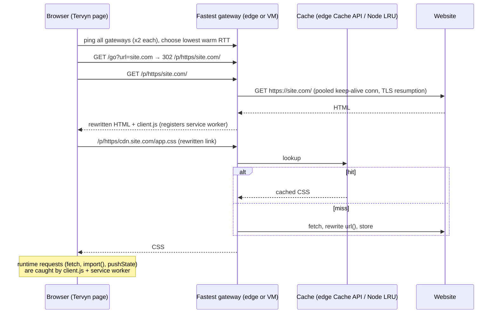

# Tervyn Web Proxy: architecture

This doc turns the "high-performance web proxy" plan into what is built here, and records the trade-offs. The goal is a free, no-install web proxy for Tervyn that is much faster than browser-based proxies routed through a few residential exits. The target is about 10× lower page-load time, still to be measured with `bench/`.

## Decision: one Web-standard gateway, deployed on every free tier

The plan compared six stacks. The choice: write the gateway once against the Web-standard `Request`/`Response`/`fetch` API, then run it everywhere it's free.

| Stack from the plan | Used? | Why |
|---|---|---|
| Serverless edge (Cloudflare Workers, Fastly, Lambda@Edge) | **Yes**: Cloudflare Workers, Deno Deploy, Vercel Edge, Netlify Edge | Free plans, anycast or multi-region, HTTP/3 + TLS 1.3 + DDoS protection with no work. Same code on all four. |
| Caddy | **Yes**, in front of the Node gateway on VMs | Automatic HTTPS, HTTP/3, TLS 1.3, 3-line config. |
| Node (custom) | **Yes**, `platforms/node` | Needed for raw TCP: exit countries through free SOCKS5/HTTP proxies, DNS-time private-IP checks, explicit keep-alive pools. |
| NGINX `proxy_pass $arg_url` | No | Can't rewrite HTML/cookies/redirects without Lua/njs; dynamic `proxy_pass` with user input is an SSRF footgun. |
| Envoy dynamic forward proxy | No | Built for clients configured to use a proxy (absolute-URI requests). A browser tab can't do that without an install. |
| HAProxy + Varnish, Squid | No | Same issue (forward proxies need client config); caching is covered by the edge Cache API and the Node LRU. |

**Forward proxy vs. web proxy.** A true forward proxy (CONNECT tunnel, as Shifter describes) needs the browser to be configured to use it. The Tervyn **extension** already does exactly that with free SOCKS5/HTTP servers. The no-install path has to be a **rewriting web proxy**: the browser talks to the gateway's own HTTPS origin, and the gateway fetches the site. The cost is that the gateway sees page content. The README states this plainly.

## Request flow

## Bottlenecks from the plan → what the code does

| Bottleneck | Mitigation | Status |
|---|---|---|
| Distance to proxy (RTT) | Edge platforms in many cities; client-side race picks the lowest warm RTT across *all* gateways | Done |
| TLS / TCP handshakes, browser → gateway | HTTP/2 + HTTP/3 + TLS 1.3 + 0-RTT/resumption by the platforms; Caddy on VMs; one origin per gateway means one multiplexed connection for every subresource | Done (platform features) |
| Handshakes, gateway → site | Keep-alive pools (256 sockets/host), TLS session cache (1000), LIFO scheduling on Node; edge runtimes pool internally | Done |
| TCP slow start / initcwnd | `tune-linux.sh`: BBR, `tcp_slow_start_after_idle=0`, bigger buffers, TCP Fast Open | Done (VMs) |
| No caching | Shared cache for public static assets that respects `Cache-Control`; never for HTML, cookies, `Authorization` or `Range` | Done |
| Compression cost | Brotli q4 on Node (dynamic text); edges compress natively; upstream asks for gzip/br and decodes once | Done |
| Streaming / large files | Bodies stream; `Range` passes through; no buffering except HTML/CSS that must be rewritten | Done |
| Redirect hops | `/go` → one 302; `/p/` URLs keep relative links valid; Location rewritten | Done |
| Escaped requests (JS-built URLs) | client.js patches + service worker + Referer fallback on the server | Done |
| Cloudflare free 10 ms CPU limit on big HTML | Native streaming `HTMLRewriter` on Cloudflare (`gateway/htmlrewriter.js`); buffered fallback only for non-UTF-8 pages | Done |
| WebSockets | Cloudflare passes the site's socket through; Deno and Node bridge it; client.js maps `ws(s)://` URLs | Done (not on Vercel/Netlify) |
| Early hints | Send `103 Early Hints` / `Link: preload` for CSS found in `<head>` | Later |

## Security

- **SSRF guard** (`gateway/url.js`): blocks private, loopback, link-local and metadata IPv4/IPv6, IPv4-mapped IPv6, `localhost`/`.local`/`.internal` names, single-label hosts, risky ports and credentials in URLs. On Node, every DNS answer is checked again at connect time, which stops DNS rebinding to private IPs.
- **Origin isolation:** cookies are re-scoped to `/p/<scheme>/<host>/`; `Domain=` is dropped; `__Host-` cookies are renamed so browsers keep them. Gateway-internal cookies (`tervyn_*`) are never forwarded.
- **Privacy:** the client IP, `X-Forwarded-*`, platform headers and `Sec-Fetch-*` are stripped. `Referer`/`Origin` are translated back to the real site. Pages get `Referrer-Policy: same-origin`, so the gateway URL never leaks to third parties.
- **Abuse:** a per-IP token bucket (default 900 req/min), a 10 MB upload cap, and `robots.txt: Disallow: /`. Edge platforms add their own DDoS protection.
- **A site's own service worker is blocked**, both server-side (`Service-Worker: script` gets a no-op) and client-side (`register` is refused), so a site can't take over the gateway origin.

## KPIs and how to measure them

| KPI | Tool |
|---|---|
| TTFB and total time per site, direct vs each gateway vs other proxies | `bench/compare.sh` (median of N, `OTHER=` for a competitor URL template) |
| First contentful paint, load event, cold cache | `bench/pageload.mjs` (Playwright, new context per run) |
| Throughput, p50/p99 latency per node, HTTP/2 vs HTTP/3 | `bench/load.sh` (oha / wrk / autocannon) |
| Upstream time vs gateway overhead | `Server-Timing: upstream;dur=…` on every proxied response |
| Cache effectiveness | `x-tervyn-cache: HIT` header |

Run benchmarks from several networks (home broadband, a 4G hotspot, cloud VMs in the US, EU and Asia). "10× faster" should be claimed only from these numbers.

## Experiments, in priority order

1. **Gateway race accuracy:** does the gateway with the lowest warm ping also give the lowest page-load time? If not, use a small real fetch through each gateway (e.g. a cached 10 KB asset) as the probe.
2. **HTTP/3 vs HTTP/2** to the gateway on lossy mobile links (`bench/load.sh` with oha).
3. **Cache hit rate** after a day of real use; tune which content types are cached.
4. **Cloudflare CPU time per large page** with the streaming HTMLRewriter (watch the Workers analytics for CPU-limit errors).
5. **Exit-country latency:** how many tested free proxies per country stay alive between re-checks (every 4 min) and the extra latency they add.
6. **Brotli level 4 vs 5 vs gzip** on the Node gateway: CPU per MB vs bytes saved.

## Roadmap

| Step | Status |
|---|---|
| Core gateway, rewriting, cookies, SSRF guard, rate limit | Done |
| Adapters: Cloudflare, Deno, Vercel, Netlify, Node | Done (Cloudflare + Deno tested on their real runtimes in CI; Vercel/Netlify adapters unit-tested) |
| Home page with the all-gateway race; in-page toolbar; service worker | Done (browser-tested) |
| Free exit countries (18 public lists, TLS-verified) on Node | Done |
| Benchmarks, CI, deploy workflow | Done |
| Cloudflare HTMLRewriter path, WebSockets | Done |
| Automated deploy to all free platforms + linking + smoke test; GitHub Pages portal | Done |
| Link the extension popup to the web proxy ("No install? Use the web version") | Next (in the extension repo) |
| Public gateway list that gateways share with each other automatically | Later |
